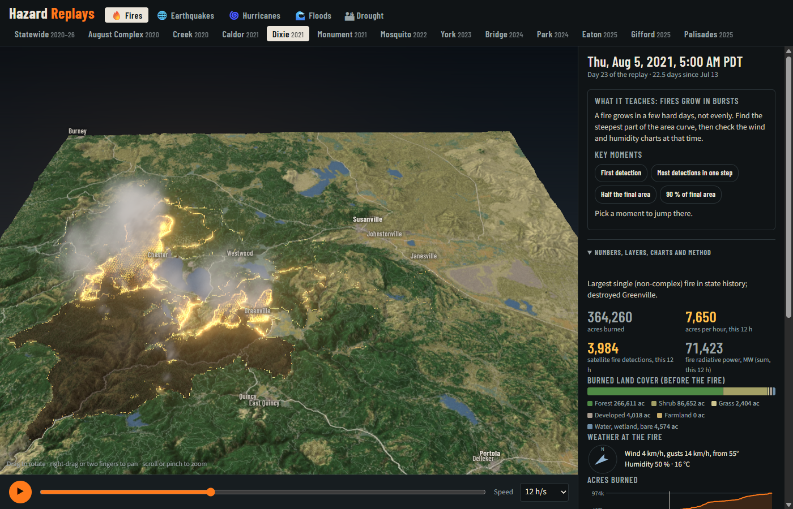

# Hazardscape

**Hazard Replays:** see how real disasters unfolded, on 3D terrain you can rotate. The page has a time slider, and the numbers on screen move with it. Every number traces back to a public dataset.



| Tab | Event | What moves |
|---|---|---|
| Fires | 12 California fires, 2020–2025: August Complex, Creek, Dixie, Caldor, Monument, Mosquito, York, Park, Bridge, Palisades, Eaton, Gifford | The fire line, plus area, spread rate, satellite detections, burned land cover, buildings inside the line, wind and humidity |
| Earthquakes | Ridgecrest 2019 (M6.4 and M7.1) | The shaking front, 5,151 aftershocks at depth, a warning-time what-if, an aftershock clock and GNSS ground motion |
| Drought | California 2020–2023 | Weekly drought maps, reservoirs against their average for the date, wells, a soil-water model, GRACE, snowpack |
| Hurricanes | Helene 2024 | The best track, modelled wind and cumulative rain |
| Floods | Helene in western North Carolina | Eight river gauges against flood stage, hourly radar rain, 1,402 mapped landslides |

Deep links jump to a moment, for example `#dixie@120`, `#ridgecrest@60` or `#helene-wnc@60`.

## Run it

```sh
cd web && python -m http.server 8000     # then open http://localhost:8000
```

The built data for every event is already in `web/data/`, so no download is needed to run it.

## Rebuild the data

```sh
cd pipeline
pip install numpy scipy pillow requests matplotlib shapely pyproj
python build_fire.py august creek dixie caldor monument mosquito york park bridge palisades eaton gifford
python build_state.py
python build_quake.py; python build_quake_extra.py
python build_drought.py; python build_drought_extra.py
python build_hurricane.py      # Helene 2024: HURDAT2 track + Open-Meteo (ERA5) rain, ~4 min first run (rate-limited)
python build_flood.py          # Helene western NC: USGS gauges, NWS flood stages, TIGER rivers, HAND
python build_phase2.py         # snowpack, reservoir averages, MRMS radar rain, landslides, soil moisture
python build_moments.py        # key-moment chips and "what it teaches" cards
python make_sources.py         # writes SOURCES.md and web/data/sources.json
python validate.py             # writes data/validation.json and checks the KPIs in docs/PLAN.md
python test_raster.py          # exact-area check for the polygon fill
python selftest.py             # headless Chrome (set CHROME=... if not found): console errors + screenshots
```

All downloads are cached in `data/raw/` and logged in `data/raw/manifest.jsonl` (URL, UTC time, bytes, sha256). `data/raw/` is about 1 GB and is not committed.

## Checks

| KPI | Target | Result |
|---|---|---|
| Final fire extent vs official polygons (equal-area) | within ±2 % | +0.4 to +1.0 % |
| Timing, 2020–21: VIIRS rebuild vs NASA FEDS | r ≥ 0.95, IoU at mid-fire ≥ 0.85 | r 0.998–1.0, IoU 0.93–0.97 |
| Timing, Park 2024 vs NIFC daily IR perimeters | median area difference ≤ 20 % | 1.0 % (n = 68) |
| Every number traceable | every file in `SOURCES.md` with URL, time, sha256, licence | done |
| Runtime | no console errors at 1400 px and 400 px | pass |

Details are in `data/validation.json` and [docs/PLAN.md](docs/PLAN.md). The data, code, UX and visual reviews are in [docs/reviews/](docs/reviews/).

## How the fire line is made

- **2020–2021 fires:** NASA FEDS 12-hourly perimeters (published product). The data are consistent with FEDS labelling each step by the start of its 12-hour window, so the pipeline shifts it by +12 h. Without the shift, FEDS runs 9–10 h ahead of our independent VIIRS rebuild. With it, FEDS is 2–3 h behind (`data/validation.json`).
- **2022–2025 fires:** this project rebuilds the perimeters from VIIRS 375 m detections in 12-hour steps. It takes each step's union of pixel footprints, closes gaps of up to one pixel, fills holes, and clips to the buffered official perimeter.
- **Extent:** every fire is clipped to the official final perimeter (NIFC, made valid). Satellite pixels are 375 m and overstate small fires.
- **Inside a step:** each cell's arrival time is interpolated by its distance between the two perimeters. The line therefore moves smoothly, but timing inside a 12-hour step is an estimate.

Checks are in `data/validation.json` and summarised in the app under "Method and checks".

## Limits

- Weather is ERA5 reanalysis at one point (grid of roughly 10–30 km), not a station.
- "Buildings inside the fire line" does not mean destroyed.
- VIIRS sees each spot about four times a day. Fast runs between overpasses show up as one jump, which the interpolation smooths.

## Hurricanes and Floods tabs (Helene, 2024)

- **Hurricanes:** NHC HURDAT2 best track (hourly interpolation), Saffir-Simpson ribbon, and ERA5 rain (Open-Meteo, 0.5 degree grid, cumulative from 24 Sep 00 UTC). The wind streaks are **modelled** from the best-track max wind, radius of maximum wind and 34/50/64 kt quadrant radii. They are not measured winds. ERA5 smooths local rain peaks.
- **Floods:** eight USGS gauges (15-minute gage height and discharge), NWS flood categories (NWPS API), USGS peak lists for record context, TIGERweb rivers. The blue overlay is **illustrative, not a flood map**: HAND (height above the nearest named river) against each gauge's rise, within 15 km of the gauge.
- Deep links: `#helene@75`, `#helene-wnc@60`.

## Ridgecrest actionable layers
- **Warning-time what-if** (simulated): alert = P wave (6 km/s) at the 4th-nearest CI station plus an assumed 5 s delay; warning = S arrival (3.5 km/s) minus alert time. Real alert: 7.4 s after the M7.1 (UC Berkeley news, 17 Oct 2019). Deep link `#ridgecrest@100,warn`.
- **Aftershock clock**: Reasenberg-Jones with the USGS forecast.json parameters (fitted after the fact); formula in the app under Method and checks.
- **GNSS arrows** (measured, NGL) and the ShakeMap rupture outline.

## Repo map

| Path | What |
|---|---|
| `web/index.html` | The whole app: three.js terrain, shaders, particles, charts, panels |
| `web/data/<event>/` | Built data per event (elevation, arrival times, textures, meta.json) |
| `pipeline/` | Download, build, validation and self-test scripts |
| `SOURCES.md` | Every downloaded file, with URL, time, sha256 and licence |
| `docs/` | Charter, data scouting, the actionable-layer scope, how to extend, reviews and screenshots |

## Licence

Code is MIT (see `LICENSE`). Data comes from the public sources listed in `SOURCES.md`, under their own terms.
